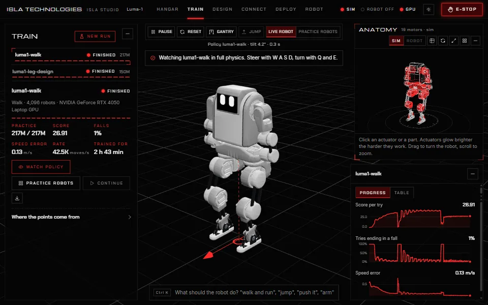
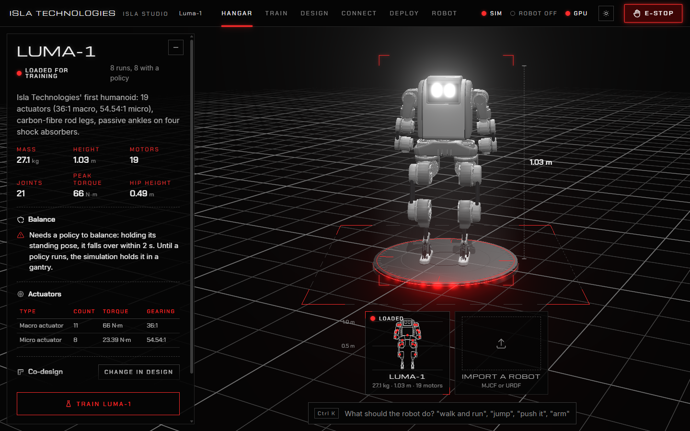
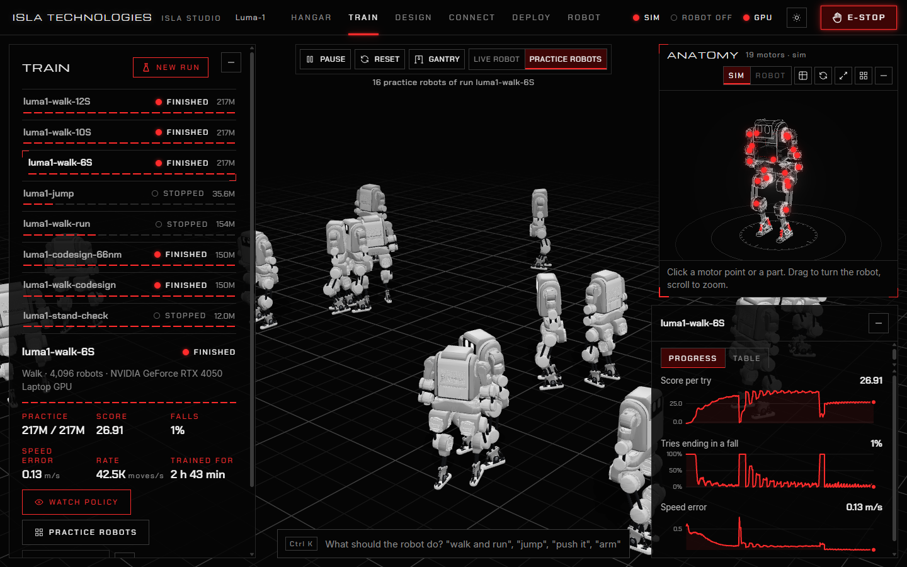
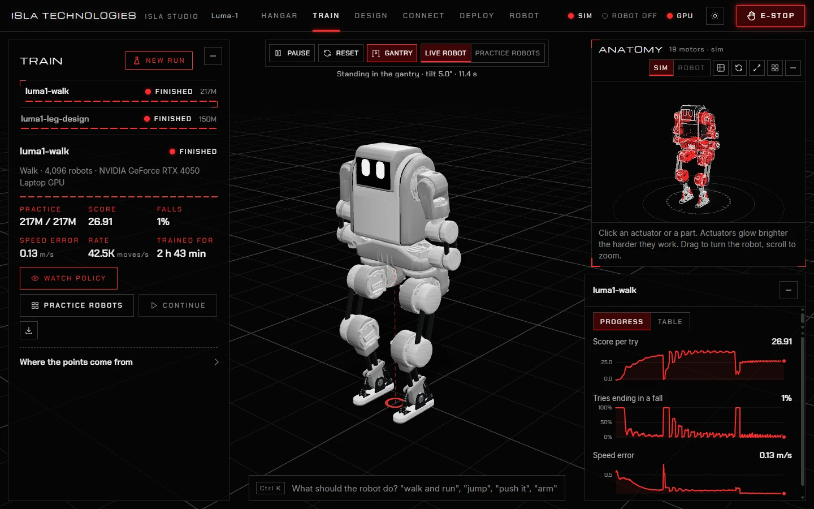
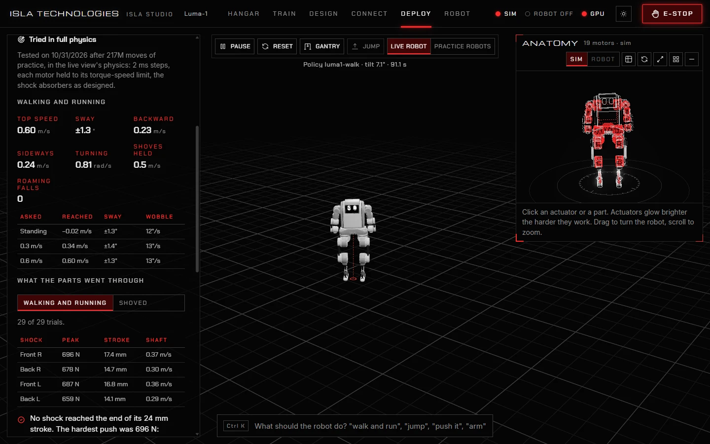
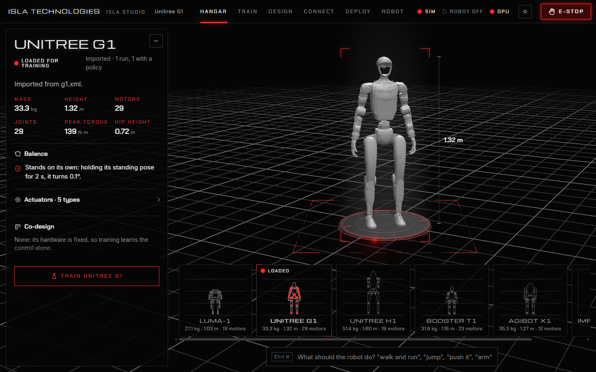

  

<h1 align="center">Isla Studio</h1>

<strong>Teach a legged robot to stand, walk and jump, on your own computer.</strong>

  <a href="#get-started">Get started</a> ·
  <a href="docs/README.md">User manual</a> ·
  <a href="docs/robots.md">Bring your own robot</a> ·
  <a href="docs/real-robot.md">Run it on hardware</a> ·
  <a href="LICENSE">MIT licence</a>

Isla Studio takes your robot's model, trains it in MuJoCo physics with reinforcement learning, tests what it learned in the physics the real robot will meet, and runs the result on your hardware over CAN. It runs on your own computer, in a Windows desktop window or your browser. There is no cloud, no account, and no code to write.

It comes with **Luma-1**, Isla Technologies' 19-motor humanoid, and two of its trained runs as examples, so you can watch it walk before you train anything. Your own robot comes in the same way, from a URDF or MJCF file: robots from Unitree, AgiBot and Booster import without edits.

## What you can do

| | |
| --- | --- |
| **Train** | Choose a lesson: stand and recover, walk, walk and run, or jump. Thousands of practice robots learn together on an NVIDIA GPU or on your processor, and the learning curves update live. |
| **Watch and steer** | Load a trained policy into the live robot and drive it with W A S D. Push it and watch it recover. |
| **Inspect actuators** | The Anatomy X-ray shows actuators inside the shell, with live motor load and state. Select an actuator to see its readings. |
| **Test** | One click tries a policy in full physics, every motor held to its torque-speed limit. You get speeds reached, falls, shoves survived, and the peak load on every motor and shock absorber. |
| **Design** | Change the hardware, such as rod lengths, springs and dampers, and see what the physics says before you build. Or let training choose the design for you (co-design). |
| **Run on the robot** | Connect over USB-CAN or the robot's own computer. Arming ramps the stiffness up gently under safety limits, and Esc is the emergency stop. A practice robot lets you rehearse all of it with no hardware. |

<table>
  <tr>
    <td width="50%"></td>
    <td width="50%"></td>
  </tr>
  <tr>
    <td><b>Hangar.</b> Every robot you have, with its figures. Load one for training or import a new one.</td>
    <td><b>Practice robots.</b> Training runs thousands of robots at once. Watch a sample of them learn.</td>
  </tr>
  <tr>
    <td></td>
    <td></td>
  </tr>
  <tr>
    <td><b>Train.</b> Your runs, how far each has got, and how its score and falls changed.</td>
    <td><b>Test.</b> What a policy does in full physics, and what the parts go through.</td>
  </tr>
</table>

## Get started

**Windows desktop app:** on Windows 10 or 11 (64-bit), install the Windows setup `.exe`, then open **Isla Studio** from the Start menu. Python, Luma-1 and its trained examples are included. Your robots, runs, policies and settings live in **Documents/Isla Studio**, separate from the installed app. The initial installer is unsigned. See [Install and start](docs/getting-started.md) for moving existing projects and [the desktop build guide](desktop/README.md) to build the installer from this checkout. macOS and Linux use the source launcher below.

**From source, on Windows, macOS or Linux:**

1. **Install Python 3.10 or newer** from [python.org](https://www.python.org/downloads/). On Windows, tick *Add python.exe to PATH* in the installer.
2. **Download Isla Studio.** On this page choose *Code*, then *Download ZIP*, and unzip it. Or clone it with `git clone https://github.com/Isla-Technologies/isla-studio.git`.
3. **Start it:**

   | Computer | Do this |
   | --- | --- |
   | Windows | Double-click `run.cmd`. |
   | macOS | Double-click `run.command`. The first time, right-click it and choose *Open*. |
   | Linux | Run `sh run.sh` in a terminal. On Ubuntu or Debian, first run `sudo apt install python3-venv`. |

   The first start downloads what Isla Studio needs, which takes a few minutes. Then your browser opens **<http://localhost:8848>**.

4. **Watch Luma-1 walk.** Open **Train**, choose the example run **luma1-walk**, and press **Watch policy**. Hold **W** to walk, **A** and **D** to side-step, **Q** and **E** to turn, and Shift-drag on the robot to push it.
5. **Train your own.** Press **New run**, choose **Stand and recover**, then **Start training**, and watch the falls curve drop. When it flattens, press **Watch policy** to try what it learned.

The [user manual](docs/README.md) walks through everything from there.

### What you need

| | |
| --- | --- |
| **A computer** | Windows with the desktop installer, or Windows, macOS or Linux with Python 3.10 or newer for the source launcher. |
| **An NVIDIA GPU** (optional) | It trains about five times faster than a processor. On a laptop RTX 4050, the stand-and-recover lesson takes about ten minutes. Install GPU support once from **Train**: **New run**, then **Install NVIDIA GPU support**. macOS trains on the processor. |
| **A robot** (optional) | Everything works in simulation. For hardware you need motor drives that speak the MIT protocol or ODrive CANSimple, and a USB-CAN adapter or a Linux computer on the robot. See [Run it on a real robot](docs/real-robot.md). |

## Bring your own robot

Open the hangar, choose **Import a robot**, and give Isla Studio your robot's folder: an MJCF (`.xml`) or URDF (`.urdf`) model with its STL, OBJ or MSH meshes. Isla Studio finds the base, the feet, which way the robot faces, its standing pose and its motors, and writes what it found into a profile you can check and correct.

Unitree G1 and H1 and Booster T1 (MuJoCo Menagerie models) and AgiBot X1 (its URDF) all import without edits. See [Bring your own robot](docs/robots.md).

## User manual

1. [Install and start](docs/getting-started.md): installing, starting, GPU support, and a tour of the screen
2. [Robots](docs/robots.md): the hangar, importing your robot, and checking its profile
3. [Training](docs/training.md): choosing a lesson, following a run, and watching and testing what it learned
4. [Design](docs/hardware-design.md): changing the hardware, and letting training choose it
5. [Run it on a real robot](docs/real-robot.md): connecting, safety, arming, and running a policy
6. [Troubleshooting](docs/troubleshooting.md)

## How it is built

The Windows app has a **Rust/Tauri desktop shell** that manages its window, startup and shutdown. The bundled **Python core** still handles robot import, simulation, training, hardware control and the local API. The interface is **TypeScript**, and MuJoCo provides the native physics engine. The public browser demo runs its own TypeScript and WebAssembly runtime.

The core has not been ported to Rust yet. See [Architecture](docs/architecture.md) for the current responsibilities and [the staged Rust migration plan](docs/rust-migration.md) for the proposed work and checks before switching each component.

## Contributing

Bug reports and pull requests are welcome. [CONTRIBUTING.md](CONTRIBUTING.md) explains how to set up, test and build.

## Licence

Isla Studio is open source under the [MIT licence](LICENSE), and so is everything in this repository, including Luma-1's model in `robots/luma_1`. It builds on [MuJoCo](https://github.com/google-deepmind/mujoco) (Apache 2.0). It ships the Michroma, Chakra Petch and Inter fonts (SIL Open Font License) and Tabler icons (MIT), each with its licence in `ui/src/brand`.

Made by [Isla Technologies](https://github.com/Isla-Technologies) in Penang, Malaysia. Luma-1's actuators are open source too: the [Macro-Actuator](https://github.com/Isla-Technologies/Macro-Actuator) and the [Micro-Actuator](https://github.com/Isla-Technologies/Micro-Actuator).
