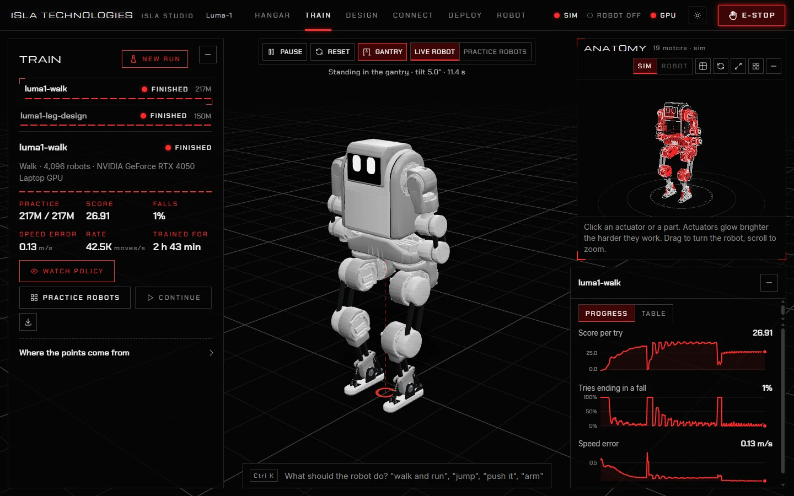
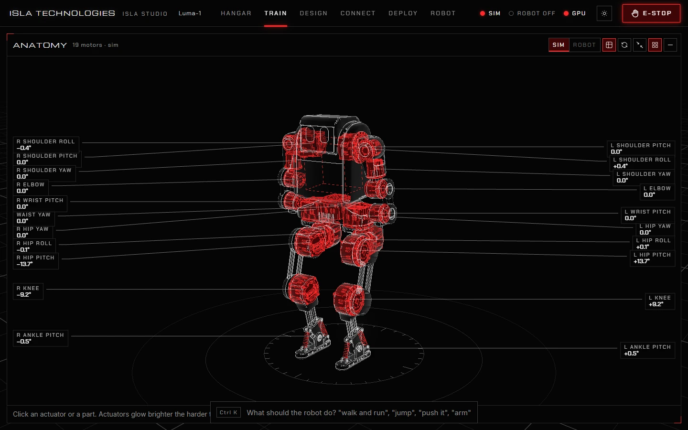
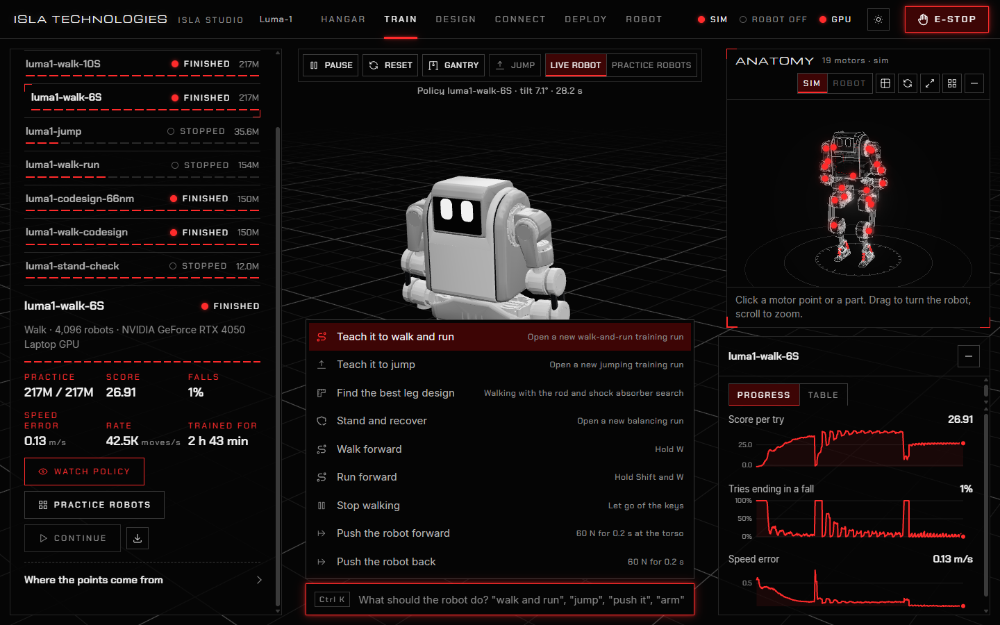
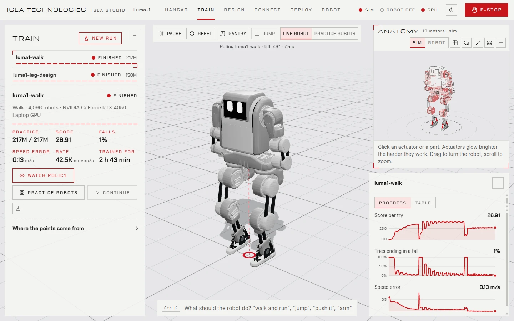
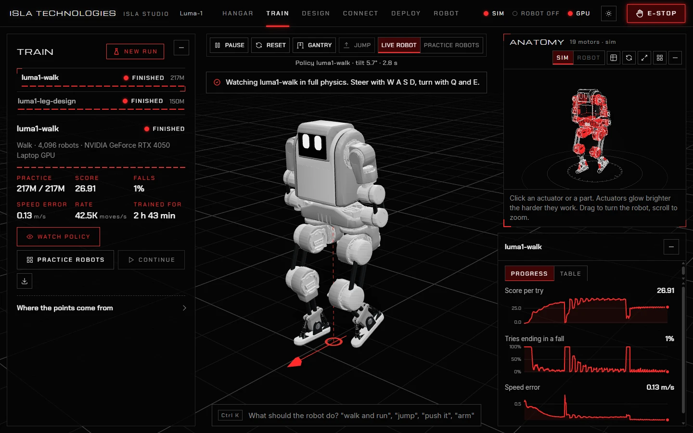

# 1. Install and start

## Install

Isla Studio runs on Windows, macOS and Linux. It needs **Python 3.10 or newer**; the first start installs everything else.

1. Install Python from [python.org](https://www.python.org/downloads/). On Windows, tick **Add python.exe to PATH** in the installer. On Ubuntu or Debian, also run `sudo apt install python3-venv`.
2. Download Isla Studio: on the [repository page](https://github.com/Isla-Technologies/isla-studio), choose **Code**, then **Download ZIP**, and unzip it anywhere. Or clone it:

   ```sh
   git clone https://github.com/Isla-Technologies/isla-studio.git
   ```

## Start

| Computer | Start Isla Studio |
| --- | --- |
| Windows | Double-click `run.cmd`. |
| macOS | Double-click `run.command`. The first time, right-click it and choose **Open**. Or run `sh run.sh` in Terminal. |
| Linux | Run `sh run.sh` in a terminal. |

The first start creates a private Python environment in the `.venv` folder and downloads what Isla Studio needs. This takes a few minutes and needs the internet. Later starts take seconds.

Your browser then opens **<http://localhost:8848>**. The screen is a page in your browser, but everything runs on your computer: nothing is uploaded.

To stop Isla Studio, close its terminal window or press Ctrl+C in it. Training runs keep going on their own, and Isla Studio picks them up when it starts again.

### Start options

Add options after the script's name, for example `run.cmd --port 8849`:

| Option | What it does |
| --- | --- |
| `--host 0.0.0.0` | Lets other devices on your network open Isla Studio, such as a tablet beside the robot, at `http://<this computer's address>:8848`. |
| `--port 8849` | Uses another port, if 8848 is taken. |
| `--robot luma_1` | Loads this robot instead of the last one used. |
| `--no-browser` | Starts without opening a browser. |

## NVIDIA GPU support

An NVIDIA GPU trains about five times faster than a processor. Isla Studio can use one on Windows and Linux, with a current NVIDIA driver (CUDA 12). macOS trains on the processor.

To install GPU support, open **Train**, press **New run**, and press **Install NVIDIA GPU support**. It is a large download and takes a few minutes; Isla Studio tells you when it is done and whether the GPU is ready. You can also install it from a terminal in Isla Studio's folder:

```sh
.venv\Scripts\python -m pip install -r requirements-gpu.txt     # Windows
.venv/bin/python -m pip install -r requirements-gpu.txt         # Linux
```

The first training run on a GPU spends a few minutes compiling before it starts.

## The screen



- **Top bar.** The six pages: **Hangar**, **Train**, **Design**, **Connect**, **Deploy** and **Robot** (keys 1 to 6). On the right, three lights show the simulation (SIM), the real robot (off, connected or armed) and whether training can use a GPU (GPU) or only the processor (CPU). Then the light and dark switch and the **E-STOP** button.
- **Left panel.** The page's controls. The `–` button folds it away.
- **Live view.** The robot in the live simulation, in full physics. Drag to orbit, scroll to zoom, double-click to frame the robot, and Shift-drag on the robot to push it. The toolbar above it pauses, resets and hangs the robot in a gantry, and switches between the live robot and the practice robots of a run.
- **Anatomy.** The robot drawn as a wireframe, with a point on every motor that lights up as the motor works. Click a motor point or a part to select it. The buttons show every motor's label, switch between the simulation's and the real robot's readings, enlarge it or make it full screen.



### Keys

| Key | What it does |
| --- | --- |
| W, A, S, D | While a policy runs: walk forward, left, back, right. |
| Q, E | Turn left, turn right. |
| Shift with W | Run, for policies that learned to run. |
| J | Jump, for policies that learned to jump. |
| Space | Pause or run the simulation. |
| R | Reset the simulation. |
| 1 to 6 | Go to a page. |
| Ctrl K | Open the command bar. |
| Esc | Emergency stop for a connected robot. |

### The command bar

Press **Ctrl K**, or click the bar at the bottom, and type what you want in plain words: "teach it to walk", "jump", "push it", "arm", "light mode". Choose a match with the arrow keys and Enter.



### Light and dark

The sun or moon button beside the E-stop switches between the dark and light themes (or type "light mode" in the command bar). Isla Studio remembers your choice; until you choose, it follows your computer's setting.



## Your first ten minutes

Isla Studio comes with **Luma-1** and two of its trained runs, so you can see a trained robot before you train your own.

1. **Watch a trained robot walk.** Open **Train** and choose the run **luma1-walk**. Press **Watch policy**. Luma-1 leaves the gantry and balances on its own; hold **W** to walk forward, **A** and **D** to step sideways, **Q** and **E** to turn. Shift-drag on the robot to push it.

   

2. **See how it learned.** On the right, the curves show its score rising and its falls dropping over 217 million moves of practice. Press **Practice robots** to watch sixteen of the robots it practised with.
3. **See how it tested.** Open **Deploy** and choose **luma1-walk**. **Tried in full physics** shows its top speed, how far it can be shoved, and the loads on every motor and shock absorber.
4. **Train your own.** Open **Train**, press **New run**, choose **Stand and recover**, and press **Start training**. On a laptop GPU it takes about ten minutes; on a processor, about twenty. Watch the falls curve drop, then press **Watch policy** to try it. See [Training](training.md).

The other example, **luma1-leg-design**, is the run that chose Luma-1's leg rods and shock absorbers while it learned to walk. See [Design](hardware-design.md).
