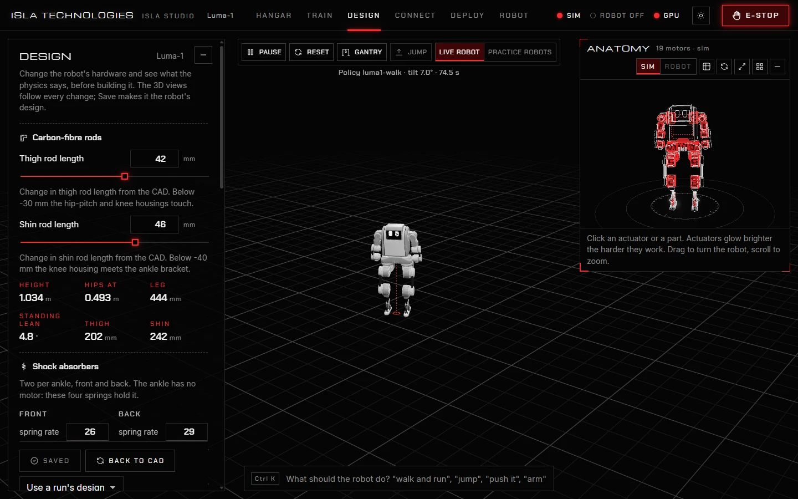
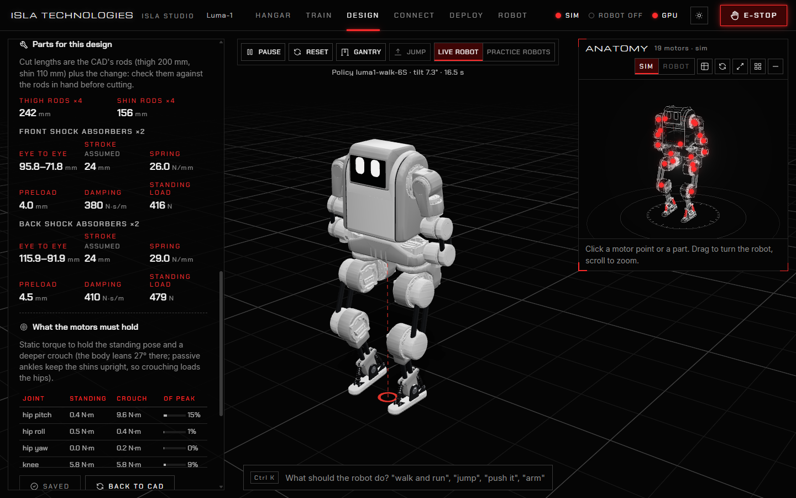

# 4. Design

Design analysis and co-design currently require the default backend. Their Rust
ports are incomplete; see [migration status](rust-migration.md).

Some robots have hardware you can still change: the length of a leg rod, the stiffness of a spring. The **Design** page lets you change it and see what the physics says before you build it. Co-design lets training choose it for you.

The page works for robots whose `robot.json` lists hardware values to change. Luma-1 lists eight: its thigh and shin rod lengths, and the spring rate, damping and preload of the front and back shock absorbers at its ankles.

## Change the hardware

Move a slider or type a value. The robot in the live view and the anatomy view change at once, and the figures update: height, hip height, leg length, how far the robot leans to stand, and the joint-to-joint lengths.

The anatomy view shows the actuators inside the shell. Click one to inspect its readings; its brightness follows motor load. The view uses the current design, including changes to the leg rods and shock absorbers.

- **Save design** makes these values the robot's design. The simulation, new training runs and the parts list use it.
- **Back to CAD** returns every value to the robot's CAD model.
- **Use a run's design** fills in the design a design-search run chose. Save it to adopt it.

Saved changes belong to the robot in your projects folder. In the Windows desktop app that is **Documents/Isla Studio/robots/**; with the source launcher it is the checkout's `robots/` folder, unless you configured another location. The desktop app's bundled Luma-1 is copied there on first start, so your saved design stays separate from the installed files.

## The parts list

**Parts for this design** turns the values on the sliders into what to make and buy:

- each rod's **cut length**, from the CAD's rod plus the change (check against the rods in hand before cutting);
- each shock absorber's length **eye to eye**, extended to compressed, its spring rate, preload and damping, and the **standing load** it carries.

**What the motors must hold** gives the torque each joint needs to hold the standing pose and a deeper crouch, as a share of the motor's peak. The walking table shows how fast the hips swing at each speed, against the motors' speed limit.

## Let training choose the design

A design search trains a walking policy while thousands of practice robots each try a different design. Every few rounds the search keeps the designs that walked best and tries new ones around them. At the end, the policy is fine-tuned on the single design it chose.

1. Open **Train**, press **New run**, and choose **Find the best leg design**. Or, under **Every option**, tick **Search the hardware design while learning**.
2. Under **Every option**, untick any values the search should leave alone, and give a **target height** if the robot must stand at one.
3. Press **Start training**. The run's panel shows the search's progress and the design it is converging on.
4. When it finishes, open **Design**, choose the run under **Use a run's design**, check the parts list, and press **Save design**.

A policy works best on the build it learned on. **Deploy** lists the design each policy trained for, and warns when it differs from the robot's saved design.

### The example: how Luma-1's legs were chosen

The example run **luma1-leg-design** is the search that chose Luma-1's legs, in 150 million moves. It chose a thigh rod 42 mm longer and a shin rod 46 mm longer than the CAD, springs of 26 and 29 N/mm, damping of 380 and 410 N·s/m, and preloads of 4 and 4.5 mm (front and back). That is Luma-1's design today.

## Hardware values for your own robot

To give your robot hardware values, add them to the `design` section of its `robot.json`, with the parts they act on in `rods` and `struts`. Luma-1's `robots/luma_1/robot.json`, under your projects folder, shows each kind: a rod's length (`rod`), and a shock absorber's spring rate (`strut_k`), damping (`strut_c`) and preload (`strut_preload`), each with its unit, range, step and help text. Close Studio before editing the file, then reopen it to load the changes.
