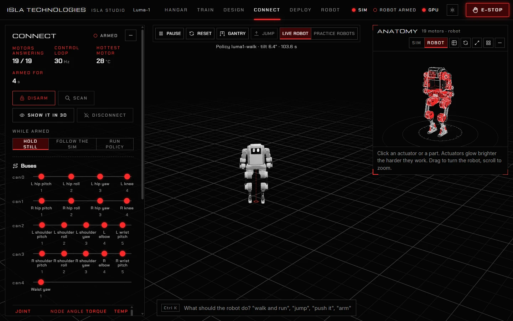
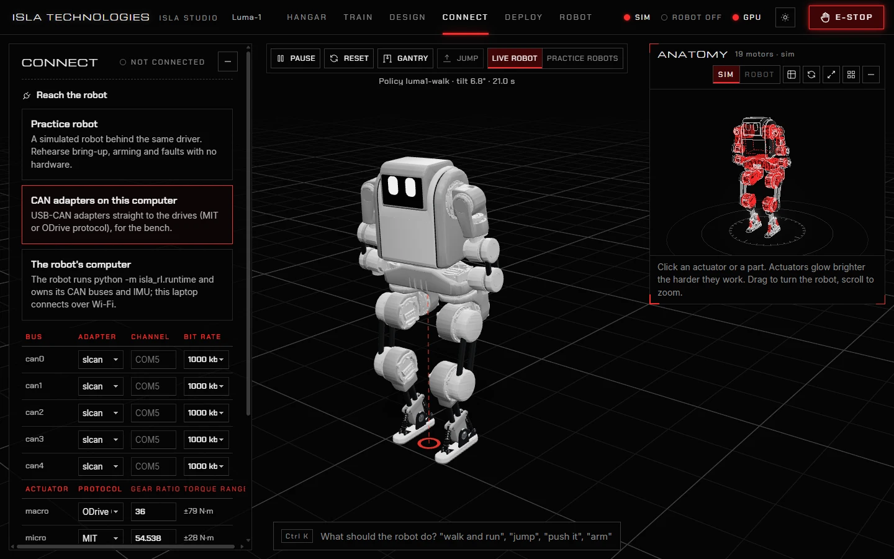
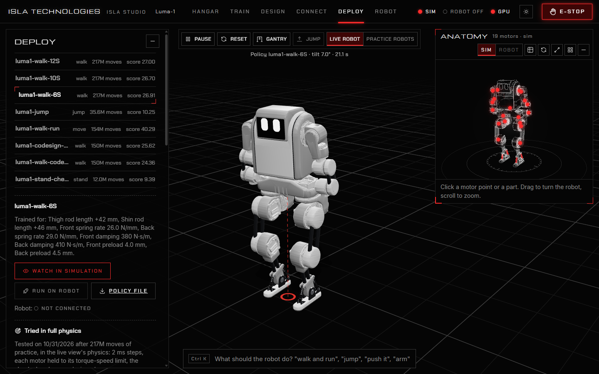

# 5. Run it on a real robot

> **Safety first.** A legged robot is heavy and its motors are strong. Hang it in a gantry with its feet clear of the floor until you trust it. Keep a hardware emergency stop that cuts motor power within reach. Isla Studio's limits and its E-stop are software; they are not a substitute.

Bring-up goes through **Connect** (reach the robot, check every motor, arm it) and **Deploy** (run a policy). Rehearse all of it with the practice robot first.

These pages work in both the Windows desktop app and browser Studio. The desktop app bundles the existing Python hardware and safety code behind its Rust window. Its robot profiles and motor maps live in **Documents/Isla Studio/robots**, and its connection settings and safety limits in **Documents/Isla Studio/settings**. The source launcher uses `robots/` and `settings/` in its checkout by default. The new desktop package has been checked with simulation and CPU training; real motor operation still needs hardware validation.

## What you need

- **Motor drives on CAN** that speak the **MIT** protocol or **ODrive CANSimple**.
- One of:
  - **USB-CAN adapters** on this computer, through [python-can](https://python-can.readthedocs.io/): CANable and other serial adapters (`slcan`), candleLight (`gs_usb`, with the extra `gs-usb` Python package), PEAK (`pcan`, with PEAK's driver), Kvaser (`kvaser`), and SocketCAN on Linux (`socketcan`). Install any adapter-specific system drivers first. The desktop installer includes the standard Studio dependencies; it does not bundle `gs-usb`. For that optional package, use a source environment and run `.venv\Scripts\python -m pip install gs-usb` on Windows, or `.venv/bin/python -m pip install gs-usb` on Linux or macOS.
  - **The robot's own computer** (a Jetson or a Raspberry Pi running Linux) owning the CAN buses and the IMU, with this computer connecting over Wi-Fi. This is the way to walk without a cable.
- The robot's **motor map**: which bus and node each joint's drive is on, its direction and its zero. Set it on the **Robot** page (see [Robots](robots.md#the-robot-page)).

## Rehearse with the practice robot

The **practice robot** is a simulated robot behind the same driver as real hardware. Everything on **Connect** and **Deploy** works with it, faults included, and nothing can break.

1. Open **Connect** and choose **Practice robot**, then **In a gantry** or **On the floor**.
2. Press **Connect**. Every motor answers, relaxed.
3. Press **Arm**, then **Disarm**; try **Rehearse a fault** (unplug a motor, overheat it, make its encoder fail) and see what the robot and the screen do; then **Clear stop**.
4. Go to **Deploy** and run a policy on it, as below.

## Connect



1. Under **Reach the robot**, choose how:
   - **CAN adapters on this computer**: for each bus, choose the adapter type, its channel (a COM port, `can0`, `PCAN_USBBUS1`…) and the bit rate. For each actuator type, choose its protocol (MIT or ODrive) and gear ratio.

     

   - **The robot's computer**: enter its address, such as `192.168.4.1:47210` (see below).
2. Press **Connect**. Every motor starts **relaxed**. Move each joint by hand and check that the model follows, in the same direction, on the anatomy view (**Show it in 3D**). The X-ray shows the internal actuators; choose **Robot** readings to inspect their measured angle and torque. A motor that stops replying turns grey, and a faulted one blinks. If one is reversed or offset, fix its direction or zero on the **Robot** page.

The panel shows how many motors answer, the control loop's rate and the hottest motor. **Buses** draws every motor on its CAN bus, and the table below gives each motor's angle, torque and temperature. **Scan** looks for drives on the buses. **Log** keeps what happened.

## Safety limits

**Safety limits** cap what the robot may do while armed. They start conservative:

| Limit | Default | What it does |
| --- | --- | --- |
| Top target speed | 2 rad/s | How fast any motor's target may move. |
| Torque allowed | 0.5 of peak | The share of each motor's peak torque it may use. |
| Stiffness allowed | 0.6 of trained | The share of the stiffness and damping the policy trained with. |
| Soft start | 2 s | How long stiffness takes to ramp up after arming. |
| Clear of joint limits | 0.05 rad | How far targets stay from each joint's end stops. |
| Stop after silence | 0.1 s | How long the motors may go unheard before everything stops. |
| Hottest allowed | 80 °C | The motor temperature that stops everything. |
| Stop when off target by | 0.7 rad | How far a joint may lag its target before everything stops. |

Disarm to change them. Policies learned with full stiffness: before running one, raise **Stiffness allowed** and **Torque allowed** near 1, and **Top target speed** to at least 3 rad/s, with the robot in the gantry.

## Arm

Press **Arm**. Stiffness ramps up from the robot's measured pose over the soft start, so it does not jump. While armed, choose what the robot does:

- **Hold still**: hold the pose it was armed in.
- **Follow the sim**: move as the live simulation does, no faster than the top speed.
- **Run policy**: run the policy chosen in Deploy.

**Disarm** relaxes every motor.

## Run a policy



1. Open **Deploy** and choose a policy. It shows the design the policy trained for, and warns if that differs from the robot's saved design.
2. Press **Watch in simulation** first, and **Test in full physics** (see [Training](training.md#test-a-policy-in-full-physics)).
3. With the robot connected and armed, press **Run on robot**. Studio evaluates the policy from the robot's sensor readings at 50 steps a second and sends its targets through the safety filter and driver. Keep Studio connected while it runs. For a jumping policy, **Jump** makes it jump.

**Policy file** downloads the policy as JSON, to run it with your own software.

Deploy's checklist, before the first run on hardware:

1. Robot in a gantry, feet clear of the floor.
2. Every motor answers, directions and zeros checked in Connect.
3. Safety limits raised for policies: stiffness and torque shares near 1, top speed at least 3 rad/s.
4. The policy's design matches the robot as built.
5. A hardware emergency stop within reach; Esc stops it from here.

## The emergency stop

**Esc**, or the **E-STOP** button in the top bar, stops a connected robot at once: every motor relaxes. A red banner says why it stopped, whether from the button or from a limit (silence, heat, a joint off its target). Fix the cause, then press **Clear stop**. The robot stays relaxed until you arm it again.

## On the robot's computer

For walking without a USB cable to this computer, the robot's own computer (Linux) owns its CAN buses and IMU. Its Python runtime streams readings and applies motor commands over Wi-Fi; Studio still evaluates the policy and applies its safety filter on the controlling computer. Keep Studio running and connected while controlling the robot. The current robot-side runtime does not run a policy independently.

The Windows desktop installer is for the controlling computer. Set up the source checkout and Python runtime separately on the robot's computer:

1. Copy Isla Studio to the robot's computer and set it up once: `sh run.sh --no-browser`. Stop it with Ctrl+C when it says it is running.
2. Start the robot's side:

   ```sh
   .venv/bin/python -m isla_rl.runtime --robot luma_1
   ```

   Add `--practice` to rehearse with a simulated robot there (`--floor` puts it on the floor), and `--port` to listen on another port than 47210.
3. On this computer, in **Connect**, choose **The robot's computer** and enter its address and port.

If this computer falls silent while the motors are enabled (`--watchdog` seconds), the robot relaxes them.

Disarm and disconnect before closing Studio. A normal desktop-window close requests the server's shutdown and disconnects its hardware link; this does not replace the bring-up checks or hardware emergency stop.
