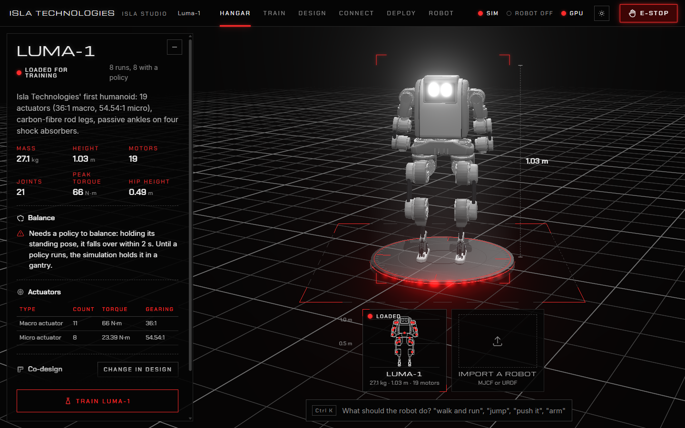
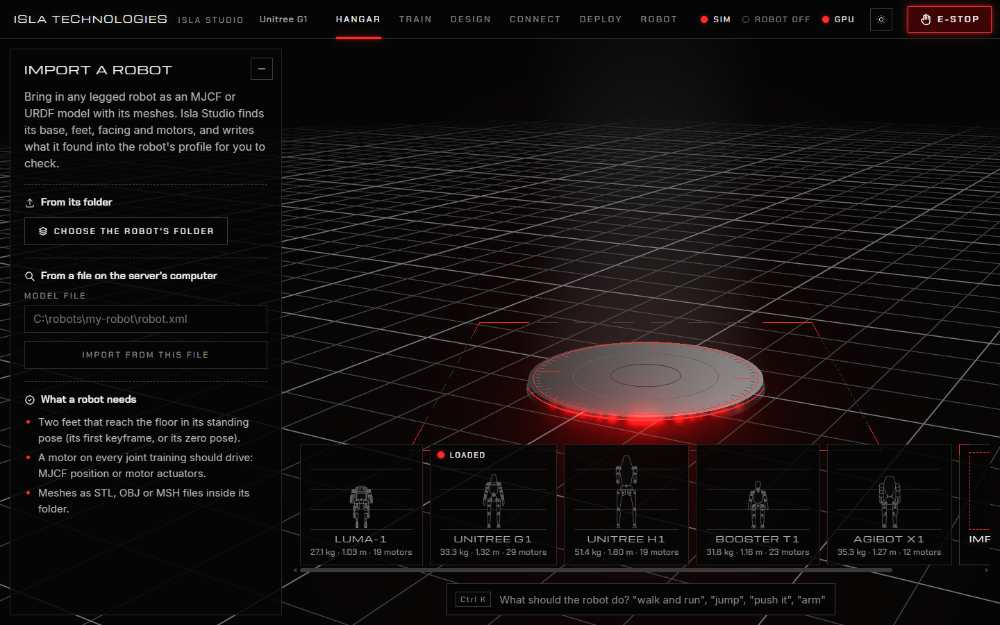
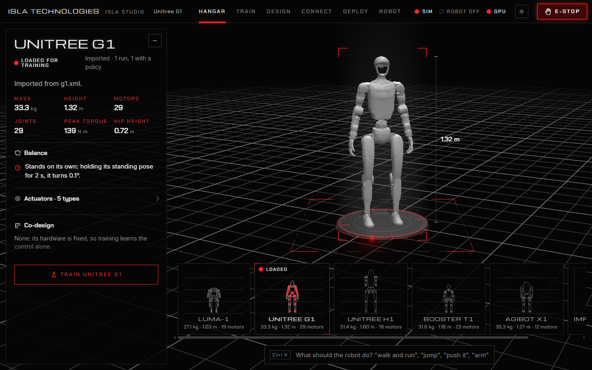
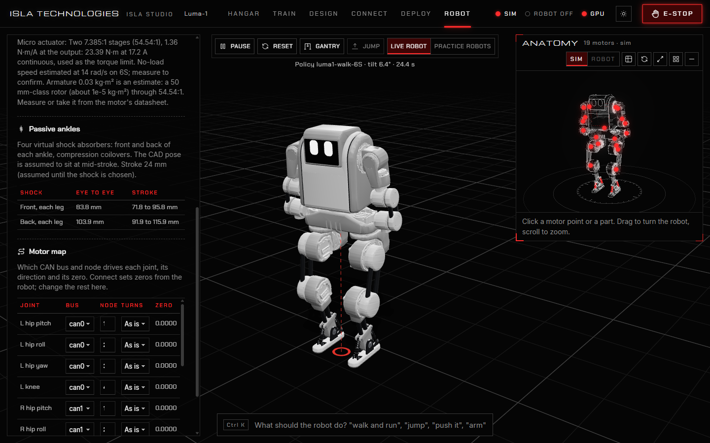

# 2. Robots

## The hangar

The **Hangar** holds every robot Isla Studio knows. Each has a bay at the bottom; click one to put it on the turntable and look it over.

The panel shows the robot's figures: mass, height, motors, joints, peak torque and hip height. When the robot on the turntable is not the one loaded for training, each figure also shows the difference from the loaded one. Below them:

- **Balance** says whether the robot can stand by holding its pose. Most robots cannot: they need a policy to balance. Until one runs, the live view hangs the robot in a **gantry**, as real robots hang during bring-up.
- **Actuators** lists its motor types with their torque and gearing.
- **Co-design** says which of its hardware values training may choose, if any. See [Design](hardware-design.md).

**Train *robot*** (or **Load *robot* for training**) makes it the robot every page works on. Isla Studio remembers it for next time. **Remove from the hangar** deletes a robot you imported.

Each robot is a folder in `robots/`: its model in `source/`, and its profile, `robot.json`.

## Bring your own robot

Isla Studio trains robots that walk on two feet: humanoids and other bipeds. It takes the robot's model as **MJCF** (`.xml`, MuJoCo's format) or **URDF** (`.urdf`), with its meshes as STL, OBJ or MSH files.

1. Open the **Hangar** and click the **Import a robot** bay.
2. Either press **Choose the robot's folder** and pick the folder that holds the model and its meshes, or type the path of the model file under **From a file on the server's computer** and press **Import from this file**.
3. Isla Studio reads the model and adds the robot to the hangar. Check what it found (below), then press **Train *robot***.

The robot needs:

- **Two feet that reach the floor** in its standing pose: the model's first keyframe, or its zero pose if it has none.
- **A motor on every joint training should drive.** In MJCF, position or motor actuators. A URDF has no actuators MuJoCo can read, so Isla Studio puts a motor on each of its joints, as strong as the joint's `effort` limit.
- **Its meshes inside its folder.** ROS-style `package://` paths are found too.

Robots fixed to the world, such as robot arms, are refused: Isla Studio trains robots that balance.

These robots import with no edits: Unitree G1 and H1 and Booster T1 from [MuJoCo Menagerie](https://github.com/google-deepmind/mujoco_menagerie), and AgiBot X1 from the URDF in [its training repository](https://github.com/AgibotTech/agibot_x1_train). Menagerie is a good place to find models of many robots.

## What Isla Studio finds, and how to correct it

Isla Studio reads off the model:

| It finds | How |
| --- | --- |
| The base | The body with the free joint (a URDF's root link). |
| The standing pose | The model's first keyframe, or its zero pose. |
| The feet | The parts that reach lowest, split into left and right. |
| Which way it faces | Its feet reach further ahead of the ankles than behind. |
| The motors | Every driven joint, with the model's torque limit and servo gains, or gains estimated from the torque. Each joint's limb comes from its name (hip, knee, shoulder…), and each limb gets its own CAN bus in a default motor map. |

All of it is written to `robots/<robot>/robot.json`, which you can open in any text editor. Restart Isla Studio after editing it. The parts worth checking:

| In `robot.json` | What to check |
| --- | --- |
| `name`, `about` | The name and description the hangar shows. |
| `frame` | Which axis is forward and which is left, if the robot walks sideways. |
| `feet` | The bodies that are the feet, if the wrong parts were found. |
| `actuator_types` | Each motor type's `peak_torque`, servo gains `kp` and `kd`, and `no_load_speed`. Values estimated rather than read from the model are listed in `assumed`. |
| `motors` | Each joint's motor type, CAN `bus` and `node`, `direction` and `zero`. You can also edit these on the **Robot** page. |

Luma-1's `robots/luma_1/robot.json` is a complete example, with notes on where each value came from.

## The Robot page

The **Robot** page shows the loaded robot's profile: its mass (from the CAD, plus any virtual mass for wiring and electronics), its actuators with their peak torque, gains and no-load speed, and the notes behind them. Its **Motor map** sets each motor's bus, node, direction (as is or reversed) and zero, and saves them to `robot.json`. You need the map right before you connect real hardware.
