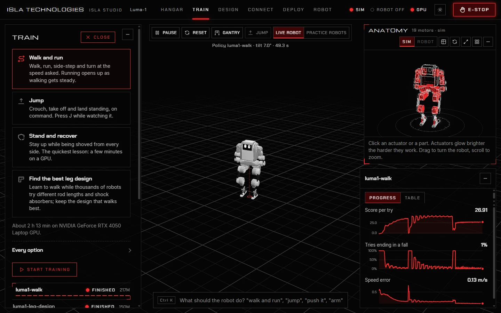
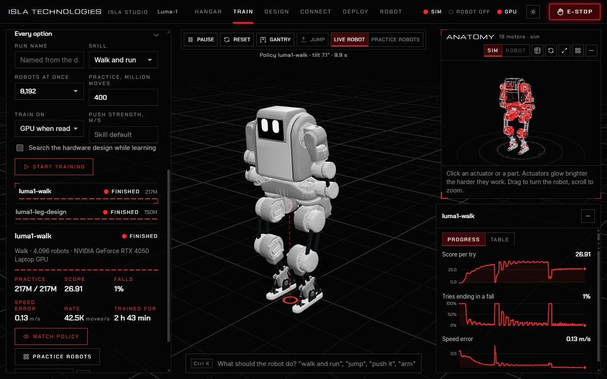
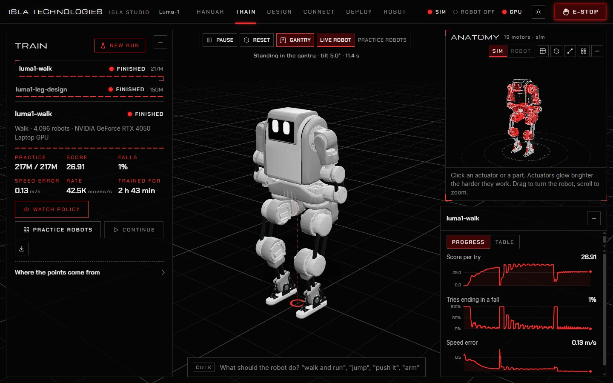
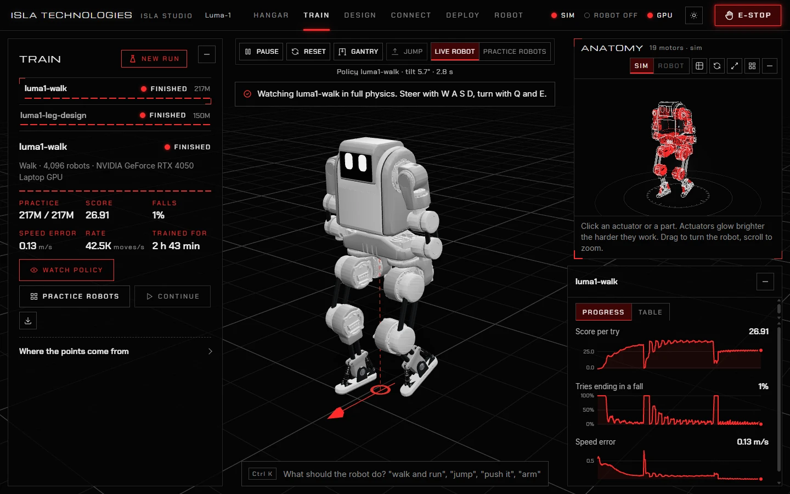
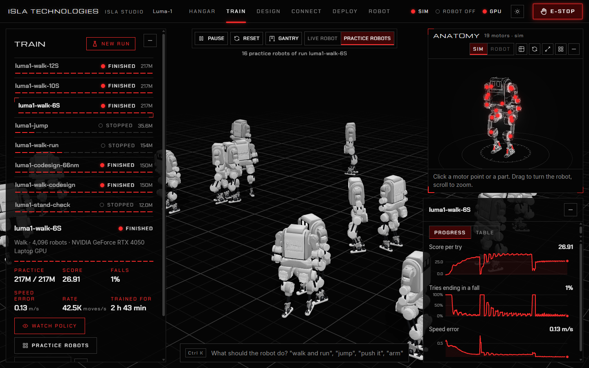
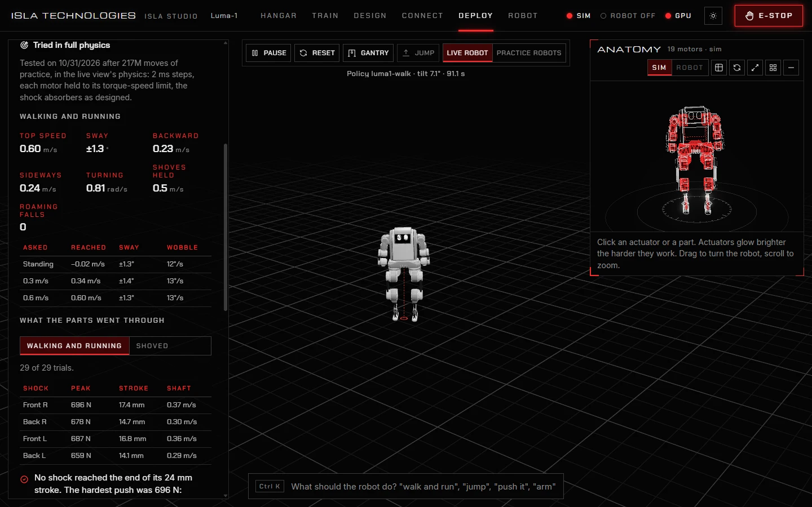

# 3. Training

This chapter applies to the default backend. The Rust candidate currently ports
policy execution and PPO/checkpoint math; its training environment, co-design
and evaluator are unfinished. See [migration status](rust-migration.md).

Training teaches the loaded robot a skill. Thousands of practice robots try it at once in simulation; the ones that do better shape the policy, and over millions of moves it learns to stand, walk or jump.

The Windows desktop app includes everything needed to train on the processor. NVIDIA GPU support is an optional download from **Train**, under **New run**; see [GPU setup](getting-started.md#nvidia-gpu-support). The same training controls work in the desktop window and the browser version.

In this chapter, `runs/` means **Documents/Isla Studio/runs** in the Windows desktop app, or the checkout's `runs/` folder when using the source launcher. See [Install and start](getting-started.md) before moving projects between them.

## Start a run



1. Open **Train** and press **New run**.
2. Choose a lesson:

   | Lesson | It learns to | Length on a GPU | On a processor |
   | --- | --- | --- | --- |
   | **Stand and recover** | Stay up while being shoved from every side, stepping if it must. The quickest lesson and the best first one. | 4,096 robots, 30 million moves | 512 robots, 15 million |
   | **Walk and run** | Walk, run, side-step and turn at the speed asked. Running opens up as walking gets steady. | 8,192 robots, 400 million moves | 512 robots, 60 million |
   | **Jump** | Crouch, take off and land standing, on command. | 4,096 robots, 200 million moves | 512 robots, 40 million |
   | **Find the best leg design** | Walk, while thousands of robots try different hardware and the search keeps what walks best. Shown for robots with hardware to choose. See [Design](hardware-design.md). | 8,192 robots, 150 million moves | 1,024 robots, 60 million |

   The panel says how long the run should take on this computer. A laptop GPU makes about 40,000 to 55,000 moves a second, a processor about 12,000.
3. Press **Start training**. A run's first start on a GPU spends a few minutes compiling.

### Every option



| Option | What it does |
| --- | --- |
| **Run name** | The run's name in the list and its folder in `runs/`. Left empty, it is named from the robot, the skill and the date. |
| **Skill** | *Stand and recover*, *Walk* (forward, backward, sideways and turning, without running), *Walk and run*, or *Jump*. |
| **Robots at once** | 256 to 8,192 practice robots. More learn faster on a GPU, but each 4,096 of a robot like Luma-1 needs about 1.3 GB of GPU memory. |
| **Practice, million moves** | How long the run trains. |
| **Train on** | The GPU when it is ready, otherwise the processor; or one of them. |
| **Push strength, m/s** | How hard the practice robots are shoved, as the speed a shove gives them. Empty uses the skill's own. |
| **Search the hardware design while learning** | Co-design: choose which hardware values the search may change, and optionally a target height. See [Design](hardware-design.md). |

## Follow a run



The runs list shows each run's state: **Running**, **Stopped** or **Finished**, and how far it has got. Choose a run to see:

- **Practice**: moves done out of moves planned.
- **Score**: points per try. It rises as the robot learns.
- **Falls**: the share of tries that end on the ground. It drops as the robot learns.
- **Speed error** (walking skills): how far its speed is from the speed asked, in m/s. **Try length** (other skills): how long tries last, in seconds.
- **Rate** and **Trained for**: moves per second, and time spent.

The curves on the right plot score, falls and speed error (or try length) over the whole run; **Table** shows the same as numbers. **Where the points come from** splits the score into the rewards that make it, such as staying up, walking at the speed asked, and not rocking.

A run saves its policy about every 30 seconds, so you can watch it while it trains. **Stop** halts a run with its progress saved, and **Continue** carries on from there. A run that finished its planned practice cannot continue: start a new run to train further.

Training runs as its own process. Closing the desktop window stops Studio's local server and live simulation, while training continues. Closing the source launcher's terminal also leaves training running. Open Studio again with the same projects folder to follow the run; press **Stop** before closing if you want training to end too. Stop runs before upgrading or uninstalling the desktop app.

## Watch and steer a policy



Choose a run and press **Watch policy**. The live robot now runs that policy in full physics.

The **Anatomy** view shows each actuator inside the robot's shell. Its red glow grows with the motor's load in dark mode; light mode uses shading without glow. Click an actuator to inspect its readings, or use **Show every motor label** to keep all the names visible. The view follows the simulated robot while a policy runs; choose **Robot** only after connecting hardware to inspect its readings instead.

- **W A S D** walk, **Q** and **E** turn. **Shift** with **W** runs, if the policy learned to run.
- **J**, or the **Jump** button, jumps, if the policy learned to jump.
- **Shift-drag** on the robot pushes it, or type "push it" in the command bar.
- **R** resets the robot, **Space** pauses, and **Gantry** hangs it up or lets it down.

## The practice robots



**Practice robots**, on the run's panel or above the live view, shows sixteen of the run's robots in a clip from their latest round of practice. Early in a run they fall about; later they walk together. **Live robot** goes back.

## Test a policy in full physics



Training uses simplified physics so that thousands of robots fit at once. Before hardware, test the policy in the live view's full physics, with 2 ms steps and every motor held to its torque-speed limit:

1. Open **Deploy** and choose the run.
2. Press **Test in full physics**. It takes a few minutes, and training carries on meanwhile.

A walking policy is asked for a ladder of speeds, then backward, sideways, turning and a curve. It is shoved from eight sides at growing strength, then roams on random commands for a minute. A jumping policy stands, is shoved, then jumps ten times. **Tried in full physics** then shows:

- the speeds it reached against the speeds asked, with its sway and wobble;
- the hardest shove it held from every side;
- how often it fell while roaming;
- **What the parts went through**: each shock absorber's peak force, stroke and shaft speed, and each motor's peak torque and top speed.

The report is saved as `runs/<run>/evaluation.json`.

## Training from the command line in a source checkout

The commands below use a source installation. Open a terminal in the checkout and use its own Python: `.venv\Scripts\python` on Windows, `.venv/bin/python` on macOS and Linux. Desktop users can start, stop and test runs through the app without a terminal.

Each run is a folder in that installation's `runs/`. To train an existing run:

```sh
.venv/bin/python -m isla_rl.learn train runs/luma1-stand --device gpu
```

| Option | What it does |
| --- | --- |
| `--device auto`, `gpu` or `cpu` | Where to train. |
| `--iterations N` | Train for N rounds of practice, then stop. |
| `--threads N` | Processor threads, when training on the processor. |
| `--no-swarm` | Do not record practice-robot clips. |

Progress prints as one line of JSON per round. Create a file named `stop` in the run's folder, or press Ctrl+C, to stop with its progress saved; the same command continues it.

```sh
.venv/bin/python -m isla_rl.learn evaluate runs/luma1-walk
```

tests a run's policy in full physics, prints the report and saves it as `evaluation.json`.

A run's folder holds `setup.json` (its settings), `progress.csv` (its curves), `checkpoint.npz` (where training stands), `policy.json` (the trained policy), and `evaluation.json` once tested.
